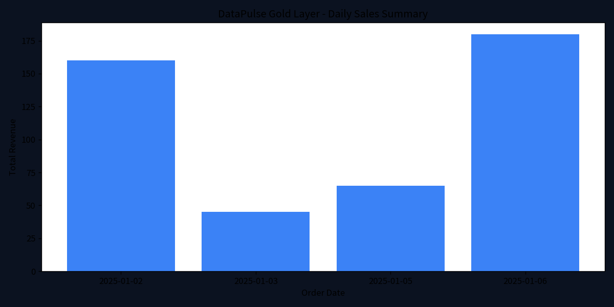
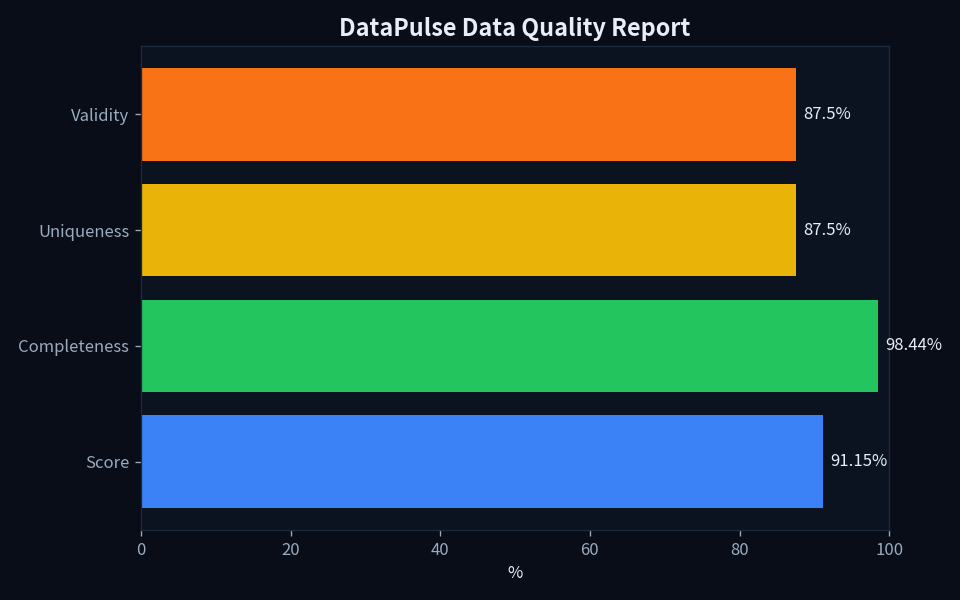
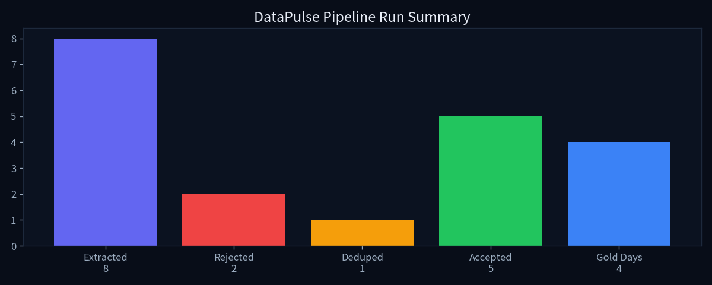
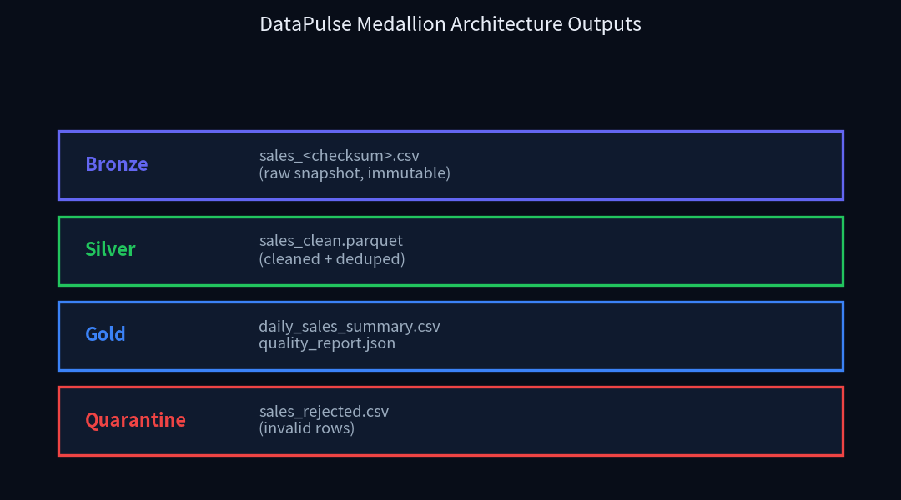
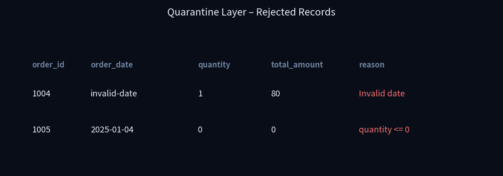
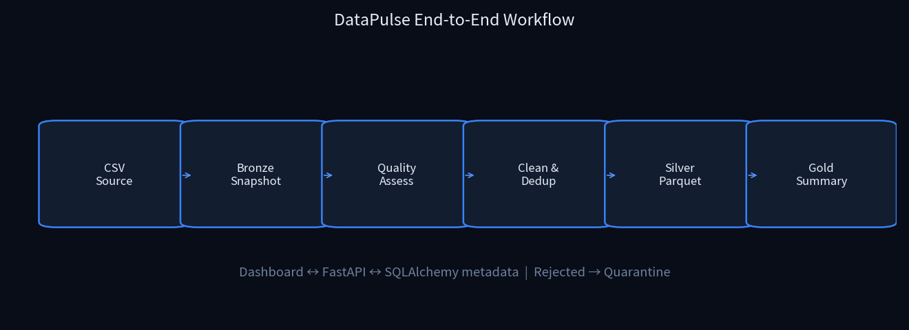
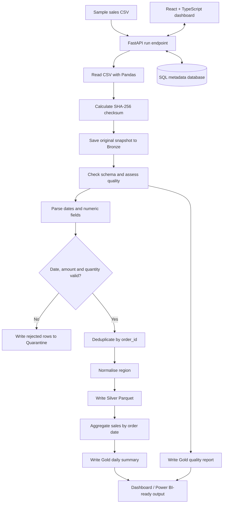

# DataPulse — Full-Stack Data Engineering & Analytics Platform


DataPulse is a portfolio project built to demonstrate how a full-stack Python developer can bring together a web-based operations dashboard, REST APIs, relational metadata storage, and a data-processing workflow. It focuses on a practical e-commerce sales use case: ingest source data, preserve the original input, assess data quality, clean and deduplicate records, separate rejected rows, and publish analytics-ready outputs.

The project combines a **FastAPI backend**, a **React + TypeScript frontend**, a **Pandas-based processing engine**, and a **SQL database**. The repository also contains integration examples for Airflow, dbt, PySpark, and Power BI.

---

## Table of contents

- [Why I built DataPulse](#why-i-built-datapulse)
- [Problem it addresses](#problem-it-addresses)
- [What the application does](#what-the-application-does)
- [Screenshots](#screenshots)
- [End-to-end workflow](#end-to-end-workflow)
- [Technology stack](#technology-stack)
- [Project structure](#project-structure)
- [How to run the project](#how-to-run-the-project)
- [API overview](#api-overview)
- [Outputs and expected results](#outputs-and-expected-results)
- [Engineering challenges and solutions](#engineering-challenges-and-solutions)
- [Current limitations](#current-limitations)
- [Future improvements](#future-improvements)
- [What this project demonstrates](#what-this-project-demonstrates)
- [License](#license)

## Why I built DataPulse

I built DataPulse to explore and demonstrate a complete application workflow rather than developing an isolated CRUD application or a standalone data-cleaning script.

In many small data workflows, source files are processed manually, quality problems are discovered late, and business users receive outputs without a clear record of how those outputs were produced. I wanted to build a single project that connects the operational side of a data workflow with the processing and analytics side.

As a **Full-Stack Python Software Developer**, I used this project to practise:

- Designing and exposing REST APIs with Python and FastAPI.
- Building an interactive dashboard with React and TypeScript.
- Persisting source, pipeline, and execution metadata with SQLAlchemy.
- Processing tabular data with Pandas and writing Parquet and CSV outputs.
- Organising a data workflow into Bronze, Silver, Gold, and Quarantine layers.
- Packaging services with Docker Compose.
- Writing automated tests and a GitHub Actions CI workflow.
- Understanding how orchestration, transformation, distributed processing, and BI tools can fit into a larger data platform.

## Problem it addresses

The demo models a common e-commerce data problem: sales records arrive in a CSV file, but the file can contain incomplete, duplicated, or invalid records. Directly aggregating such a file can lead to unreliable reports.

DataPulse demonstrates a structured approach to that problem:

| Problem in incoming data / workflow | DataPulse approach |
|---|---|
| Original input can be overwritten or lost during processing | Saves a checksum-named raw snapshot in the Bronze layer |
| Required columns may be absent | Checks the expected sales schema and fails with a clear validation error |
| Some values may be missing | Calculates a completeness measure and normalises a missing region to `Unknown` in accepted data |
| Order IDs may be duplicated | Measures order-ID uniqueness and deduplicates accepted records by `order_id` |
| Dates or quantities may be invalid | Parses dates and numeric fields, then excludes rows with invalid dates, invalid amounts, or non-positive quantities |
| Rejected records can disappear from the reporting workflow | Writes rejected rows to a Quarantine CSV for inspection |
| Business reporting needs a clean, compact dataset | Produces a daily sales summary in the Gold layer |
| Operators need visibility into pipeline activity | Provides a dashboard and API for source registration, pipeline configuration, run history, and monitoring |

**Scope note:** DataPulse currently executes one bundled e-commerce sales CSV demo. The API's source registry accepts several source-type labels, but those labels do not mean that fully working connectors for every listed system are included.

## What the application does

### Web dashboard

The React dashboard provides these views:

- **Overview:** pipeline counts, successful and failed run counts, processed-record totals, recent activity, and a quality-score panel.
- **Pipelines:** create a pipeline record and trigger the bundled sales demo.
- **Data Sources:** register and list source metadata.
- **Data Quality:** describes the quality checks and points to generated quality artifacts.
- **Catalog:** lists the local Bronze, Silver, Gold, and Quarantine output locations.
- **Settings:** shows the local development environment and service endpoints.

The dashboard is an operations interface for the included demo; it is not yet a complete enterprise data catalog or a configurable visual pipeline builder.

### Backend and processing engine

The FastAPI service exposes REST endpoints and stores metadata for data sources, pipelines, and pipeline runs. When a pipeline is run, the API calls the Pandas-based demo processing function and records the execution result.

### Data outputs

The processing engine writes:

- **Bronze:** original CSV snapshot, named using the first 12 characters of its SHA-256 checksum.
- **Silver:** cleaned and deduplicated sales records in Parquet format.
- **Gold:** daily sales aggregates in CSV format and a JSON quality report.
- **Quarantine:** records rejected by the implemented date, amount, and quantity checks.

## Screenshots

The following images illustrate the expected outputs and visual results produced by DataPulse after running the bundled e-commerce sales demo. UI dashboard screenshots match the React + TypeScript interface (dark theme operations console). Data-layer images are generated from an actual pipeline execution.

### Dashboard Overview (expected UI)
The Overview tab shows pipeline counts, successful runs, records processed, quality score, recent run history, and a quality snapshot.

### Pipeline Management (expected UI)
Create pipelines, view status, and trigger the demo batch with one click. Run results update the monitoring panel immediately.

### Gold Layer – Daily Sales Summary


Aggregated revenue, distinct orders and units by order date after cleaning and deduplication.

### Data Quality Report


Completeness, uniqueness and validity scores computed by the quality engine (overall score ≈ 91%).

### Pipeline Run Summary


Extracted → Rejected → Deduplicated → Accepted → Gold aggregation counts from a real run (8 → 2 rejected → 5 accepted).

### Medallion Data Layers / Catalog


Bronze (immutable raw snapshot), Silver (cleaned Parquet), Gold (analytics CSV + quality JSON), Quarantine (rejected rows).

### Quarantine – Rejected Records


Rows rejected for invalid `order_date` or non-positive `quantity` are written to CSV for inspection.

### End-to-End Workflow Diagram


CSV source → Bronze snapshot → Quality assess → Clean & dedup → Silver Parquet → Gold summary, with dashboard and metadata store.


## End-to-end workflow



### Workflow details

1. **Register a source (optional for the bundled demo).** The dashboard sends source metadata to the FastAPI source endpoint. The record is stored in the metadata database.
2. **Create a pipeline.** The dashboard sends a pipeline name and description to the API. The API validates the name and, if supplied, the source ID.
3. **Start a run.** Clicking **Run now** calls `POST /api/v1/pipelines/{pipeline_id}/run`.
4. **Read the input.** The current demo reads `sample_data/raw/sales.csv` using Pandas.
5. **Preserve the raw file.** The engine calculates a SHA-256 checksum and saves the original bytes in `data/bronze/`. Re-running the same input does not create another snapshot with the same checksum-based filename.
6. **Assess data quality.** The quality function checks the required columns and calculates completeness, order-ID uniqueness, date validity, and an average score from those three percentages.
7. **Validate and separate records.** The engine parses `order_date`, `total_amount`, and `quantity`. Rows with an invalid date, missing/unparseable total amount, or quantity less than or equal to zero are written to Quarantine. Other rows continue.
8. **Clean accepted records.** Accepted rows are deduplicated using `order_id` (keeping the last occurrence). Missing region values are replaced with `Unknown`, and region text is title-cased.
9. **Write Silver and Gold.** Silver is written as Parquet. Gold groups accepted records by order date and calculates revenue, distinct orders, and units.
10. **Record run metadata.** The API stores the run status, extracted/processed/rejected counts, duration, and a result message. The dashboard reloads the monitoring data.
11. **Review outputs.** Inspect the files under `data/` or import the Gold CSV into Power BI Desktop.

**Important implementation detail:** duplicate rows removed during deduplication are not currently counted as Quarantine records. The API's `records_rejected` count reflects rows rejected by the implemented validity filters, not duplicates removed later.

## Technology stack

| Area | Technologies | How they are used in this repository |
|---|---|---|
| Backend | Python 3.12+, FastAPI, Uvicorn | REST API and application server |
| Validation / configuration | Pydantic, pydantic-settings | Request schemas and environment-based settings |
| ORM / metadata | SQLAlchemy 2 | Source, pipeline, and pipeline-run models |
| Database | PostgreSQL 16, SQLite fallback | PostgreSQL in Docker Compose; SQLite is the default for a local backend run without a database URL override |
| Data processing | Pandas, NumPy, PyArrow | CSV handling, quality checks, transformations, and Parquet output; NumPy is listed as a dependency but is not directly called in the current pipeline |
| Frontend | React, TypeScript, Vite | Dashboard interface and client-side API calls |
| UI | CSS, Lucide React | Styling and interface icons |
| Web serving | Nginx | Serves the built frontend and proxies API requests in the Docker setup |
| Containers | Docker, Docker Compose | Local multi-service environment |
| Testing | Pytest, FastAPI TestClient | API health and data-quality tests |
| CI | GitHub Actions | Runs backend tests and frontend build on push and pull requests |
| Orchestration example | Apache Airflow | Example DAG that invokes the demo batch pipeline; not part of the default Compose stack |
| SQL transformation example | dbt | Example staging and daily-sales models; requires a configured dbt profile and source relation |
| Distributed processing example | PySpark | Standalone regional sales aggregation example; requires a Spark environment |
| BI examples | Power BI DAX and SQL | Example measures and a SQL view definition for analytics integration |

Airflow, dbt, PySpark, and Power BI assets are supporting examples. They are not automatically launched or fully integrated by the default Docker Compose workflow.

## Project structure

```text
datapulse/
├── backend/
│   ├── app/
│   │   ├── api/              # Health, source, pipeline and monitoring routes
│   │   ├── core/             # Settings and SQLAlchemy database setup
│   │   ├── main.py           # FastAPI application and router registration
│   │   ├── models.py         # SQLAlchemy metadata models
│   │   └── schemas.py        # Pydantic request schemas
│   ├── tests/                # API and data-quality tests
│   └── Dockerfile
├── data_engine/
│   ├── extractors.py         # CSV, Excel and JSON file readers
│   ├── pipeline.py           # Bundled Bronze-to-Gold demo pipeline
│   └── quality.py            # Schema and data-quality assessment
├── frontend/
│   ├── src/                  # React + TypeScript dashboard
│   ├── Dockerfile
│   └── nginx.conf
├── sample_data/raw/          # Bundled sales CSV and customers JSON
├── data/                     # Generated Bronze/Silver/Gold/Quarantine data
├── airflow/dags/             # Optional Airflow DAG example
├── dbt/                      # Example dbt models and project configuration
├── spark/jobs/               # PySpark example job
├── powerbi/                  # DAX measures and SQL view example
├── docs/                     # Architecture, API, security and operating guides
├── .github/workflows/        # GitHub Actions CI workflow
├── docker-compose.yml
├── requirements.txt
└── README.md
```

## How to run the project

### Option 1 — Docker Compose (recommended)

**Prerequisites**

- Docker Desktop (or Docker Engine with the Compose plugin)
- Git, if cloning from GitHub
- Available local ports: `5173`, `8000`, and `5432`

**Steps**

1. Clone the repository and open a terminal in the `datapulse` project root:

   ```bash
   git clone <your-repository-url>
   cd datapulse
   ```

2. Create the local environment file.

   **Windows PowerShell:**

   ```powershell
   Copy-Item .env.example .env
   ```

   **macOS / Linux:**

   ```bash
   cp .env.example .env
   ```

3. Start the services:

   ```bash
   docker compose up --build
   ```

4. Open the application:

   | Service | URL |
   |---|---|
   | React dashboard | http://localhost:5173 |
   | FastAPI interactive documentation | http://localhost:8000/docs |
   | FastAPI health check | http://localhost:8000/health |

5. In the dashboard, open **Pipelines**, create a pipeline, and click **Run now**.
6. Inspect the generated files in `data/bronze/`, `data/silver/`, `data/gold/`, and `data/quarantine/`.
7. Stop the services with `Ctrl+C`, then run:

   ```bash
   docker compose down
   ```

   To remove the PostgreSQL volume as well (this permanently deletes the local database data):

   ```bash
   docker compose down -v
   ```


### Option 2 — Run the backend locally

**Prerequisites:** Python 3.12+ and pip.

From the project root:

```bash
python -m venv .venv
```

Activate the environment:

**Windows PowerShell:**

```powershell
.venv\Scripts\Activate.ps1
```

**Windows CMD:**

```bat
.venv\Scripts\activate.bat
```

**macOS / Linux:**

```bash
source .venv/bin/activate
```

Install dependencies and start the API:

```bash
pip install -r requirements.txt
uvicorn backend.app.main:app --reload
```

The backend defaults to a local SQLite database (`datapulse.db`) when `DATABASE_URL` is not overridden. The API will be available at http://localhost:8000 and its interactive docs at http://localhost:8000/docs.

The frontend's Docker/Nginx configuration proxies `/api/` to the API service. The repository does not currently include a Vite development-server proxy configuration, so running `npm run dev` separately requires configuring the frontend API proxy/base URL for your local backend.

### Run tests

From the project root, with dependencies installed:

```bash
pytest -q
```

The GitHub Actions workflow also installs the Python requirements, runs Pytest, installs frontend packages, and runs the frontend production build.

## API overview

Interactive request/response schemas are available at `http://localhost:8000/docs`.

| Method | Endpoint | Purpose |
|---|---|---|
| `GET` | `/health` | API liveness check |
| `GET` | `/api/v1/monitoring/overview` | Pipeline counts, run counts, processed rows, and recent runs |
| `GET` | `/api/v1/monitoring/alerts` | Failure summary when failed runs exist |
| `GET` | `/api/v1/sources` | List registered data sources |
| `POST` | `/api/v1/sources` | Register a data source |
| `DELETE` | `/api/v1/sources/{source_id}` | Delete a registered source |
| `GET` | `/api/v1/pipelines` | List pipelines |
| `POST` | `/api/v1/pipelines` | Create a pipeline |
| `PATCH` | `/api/v1/pipelines/{pipeline_id}` | Update pipeline fields / active state |
| `POST` | `/api/v1/pipelines/{pipeline_id}/run` | Run the bundled sales batch workflow |
| `GET` | `/api/v1/runs` | List recent pipeline runs |

The run endpoint currently executes the demo batch synchronously in the API request. It is not a background-job or distributed task queue implementation.

## Outputs and expected results

The input file is `sample_data/raw/sales.csv`. It is deliberately intended to demonstrate an invalid date, a zero-quantity record, a duplicate order ID, and a missing region. The current archive has a CSV formatting defect on the order `1006` row; see [Known issue in the supplied sample file](#known-issue-in-the-supplied-sample-file) before running the workflow.

Once that CSV row is corrected to a valid nine-column record while retaining a blank region value, the intended logic yields the following result from the bundled sample:

| Metric | Expected value | Explanation |
|---|---:|---|
| Input records | 8 | Eight sales rows in the sample |
| Date/amount/quantity-invalid rows | 2 | One invalid date and one zero-quantity row |
| Records after validity filtering | 6 | Eight input rows minus two invalid rows |
| Records after order-ID deduplication | 5 | The repeated `order_id` `1002` is reduced to one row |
| Missing region handling | `Unknown` | The accepted row with a blank region is normalised |
| Total Gold revenue | 450 | Sum of accepted `total_amount` values |
| Gold order count | 5 | Distinct accepted order IDs |
| Gold units | 9 | Sum of accepted quantities |
| Data-quality score | 91.15 / 100 | Mean of completeness 98.44%, uniqueness 87.50%, and date validity 87.50% |

These are **calculated expectations for the corrected sample row**, not a claim that the uploaded ZIP was successfully executed end-to-end in this environment. The uploaded CSV currently fails at `pd.read_csv`, and the local inspection environment also did not have PyArrow installed. The project's `requirements.txt` includes PyArrow, which is needed for the Silver Parquet write when dependencies are installed.

### Generated files

| Path | Content |
|---|---|
| `data/bronze/sales_<checksum>.csv` | Raw input snapshot |
| `data/silver/sales_clean.parquet` | Cleaned and deduplicated accepted records |
| `data/gold/daily_sales_summary.csv` | Daily revenue, distinct order count, and units |
| `data/gold/quality_report.json` | Quality score, component percentages, record counts, and source checksum |
| `data/quarantine/sales_rejected.csv` | Rows rejected by the implemented validity filters |

The Gold daily summary is suitable for a basic Power BI import. Example DAX measures are in `powerbi/dax/measures.dax`.

**Dashboard metric caveat:** the monitoring API currently returns a hard-coded quality score of `96.4`, and the dashboard shows fixed component percentages (`97.2%`, `98.1%`, and `94.0%`). These are illustrative UI values, not values dynamically read from `quality_report.json`. Use the generated JSON report for the calculated sample-level quality assessment.

### Known issue in the supplied sample file

In the uploaded archive, the row for order `1006` has ten comma-separated values, while the CSV header defines nine columns:

```csv
1006,506,206,2025-01-05,2,35,5,65,,west
```

Pandas raises a `ParserError` when reading this file. Correct the row to a valid nine-column record. If the intention is to demonstrate a missing region, retain one trailing empty region field, for example:

```csv
1006,506,206,2025-01-05,2,35,5,65,
```

After correcting the sample data, install the requirements (including PyArrow) and run the workflow again.

## Engineering challenges and solutions

The following describes the engineering problems represented in the implementation and the approach used. It does not claim that every production concern has been solved.

| Challenge | Implemented approach | Why this approach |
|---|---|---|
| Keeping API code separate from data transformations | Split FastAPI routes, service layer, and `data_engine` package | Keeps HTTP concerns separate from reusable processing logic |
| Preserving source data before cleaning | Store the original bytes under a SHA-256-derived Bronze filename | Makes the raw input traceable and avoids silently overwriting the same snapshot |
| Handling inconsistent sales records | Validate required columns, parse fields, filter invalid rows, and deduplicate order IDs | Prevents the implemented invalid records from entering the curated dataset |
| Keeping rejected data available for investigation | Write invalid rows to a Quarantine CSV | Rejected records remain inspectable instead of disappearing |
| Producing analytics-ready data | Store Silver as Parquet and Gold as a daily aggregate CSV | Separates cleaned records from business-level summaries |
| Tracking operations | Persist source, pipeline, and run metadata with SQLAlchemy | Gives the dashboard an API-backed operational history |
| Supporting local setup | Provide Dockerfiles and Docker Compose for API, frontend, and PostgreSQL | Reduces environment setup differences between machines |
| Avoiding regressions in core behaviour | Add Pytest checks and a GitHub Actions workflow | Checks the health endpoint, quality logic, and frontend build during CI |

### Why the medallion-style layout?

The Bronze/Silver/Gold structure separates three responsibilities:

- **Bronze** keeps the received data as it arrived.
- **Silver** contains records after the implemented cleaning and deduplication steps.
- **Gold** contains a business-oriented aggregate that is easier to report on.

The separate **Quarantine** output makes rejected records available for review. This is a simplified local implementation of the pattern, not a full lakehouse architecture.

## Current limitations

DataPulse is a portfolio prototype and an executable vertical slice, not a production-ready enterprise data platform. The main limitations are:

1. **One active demo pipeline:** the run endpoint always invokes the bundled sales CSV workflow; pipeline records do not define arbitrary transformation graphs.
2. **CSV sample issue in this archive:** the `1006` row has an extra comma and must be corrected before the demo can read the file.
3. **Limited connectors:** CSV, Excel, and JSON helper readers exist, but the run workflow uses only the bundled CSV. REST, PostgreSQL, MongoDB, Kafka, and S3 connectors are not implemented as working integrations.
4. **Synchronous execution:** pipeline work runs inside the API request; there is no Celery/RQ worker, durable queue, retry policy, or distributed task execution.
5. **No authentication or authorisation:** JWT, user accounts, role-based access control, and audit trails are not implemented. Do not expose the app publicly as-is.
6. **Demo-only security configuration:** sample credentials and development defaults must be replaced; source credentials are not encrypted or managed through a secrets vault.
7. **Simplified data-quality rules:** only required columns, completeness, order-ID uniqueness, and date validity contribute to the quality score. The pipeline's row rejection conditions are limited to invalid date, invalid total amount, and non-positive quantity.
8. **Deduplication is not reported as rejection:** duplicate rows are dropped after the validity filter and are not counted in `records_rejected` or written to Quarantine.
9. **Limited data validation:** `unit_price` and `discount` are not comprehensively validated, and the current logic does not enforce referential integrity against the customers JSON file.
10. **Illustrative dashboard quality values:** the dashboard's quality score and component percentages are hard-coded; the calculated quality report is written to disk but is not surfaced dynamically through the monitoring API.
11. **Basic metadata schema:** only `data_sources`, `pipelines`, and `pipeline_runs` are implemented. Full users/RBAC, task-step, catalog, lineage, rule-registry, notification, and audit schemas are absent.
12. **No automated scheduling in the default stack:** the pipeline schedule field is metadata only. The Airflow DAG is an example and is not deployed by the default Compose file.
13. **Optional ecosystem assets need setup:** dbt, Spark, Airflow, and Power BI examples require their own runtime configuration and are not automatically wired into the local demo.
14. **No production observability or cloud deployment templates:** Prometheus/Grafana, alert delivery, cloud infrastructure definitions, backups, migrations, and production deployment automation are not included.
15. **Power BI refresh is manual:** the repository provides a Gold CSV and sample DAX/SQL assets, not an automated Power BI Service refresh configuration.

## Future improvements

- Fix and validate the bundled sample dataset as part of CI.
- Make the quality report the single source of truth for dashboard quality metrics.
- Add configurable source connectors and file-upload support.
- Add background execution, retries, scheduling, and run cancellation.
- Add authentication, RBAC, encrypted credentials, and audit logging.
- Expand quality rules and record deduplication/rejection metrics.
- Add data lineage, dataset metadata, and versioned pipeline steps.
- Deploy Airflow as a supported orchestration service and connect dbt/Spark jobs to the pipeline.
- Add structured logging, metrics, notifications, database migrations, and cloud deployment templates.
- Add end-to-end tests and attach real screenshots of the running application.

## What this project demonstrates

DataPulse demonstrates my work across the full-stack Python development lifecycle:

- Backend API design and implementation with FastAPI.
- Relational data modelling and persistence with SQLAlchemy.
- Frontend integration using React, TypeScript, and REST APIs.
- Data ingestion, validation, transformation, and analytics output generation with Pandas.
- Local development and service orchestration with Docker Compose.
- Automated testing and CI with Pytest and GitHub Actions.
- Understanding of the wider data ecosystem through Airflow, dbt, PySpark, and Power BI examples.

It is intended as a practical learning and portfolio project that can be extended into a more configurable, secure, and production-oriented platform.

## License

This project is distributed under the MIT License. See [LICENSE](LICENSE).

## Author

**Rohit Kumar**

Computer Science Engineering Student
Full Stack Pythone Developer
