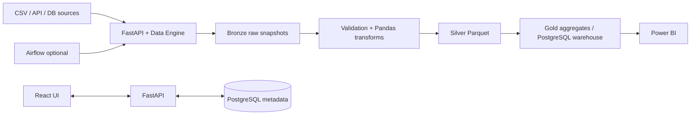

# Architecture

DataPulse uses a modular-monolith control plane (FastAPI) and an independently callable batch data engine. React is the operator UI. PostgreSQL owns operational metadata. The local batch demonstration preserves the input in Bronze, writes cleaned Parquet to Silver, business aggregates to Gold, and invalid rows to Quarantine.

Airflow, Kafka, Spark, dbt, MinIO and Redis are extension points or optional profiles; the included demo does not pretend to configure their production-grade integrations.
