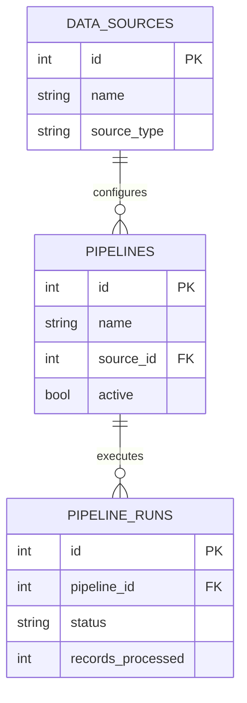

# Database schema

The operational metadata schema is created automatically by SQLAlchemy on startup. Tables included: `data_sources`, `pipelines`, and `pipeline_runs`. The full enterprise schema in the specification (users/RBAC, versioned pipeline steps, task runs, catalog, lineage, quality rule registry, notifications and audit logs) is not yet implemented.

